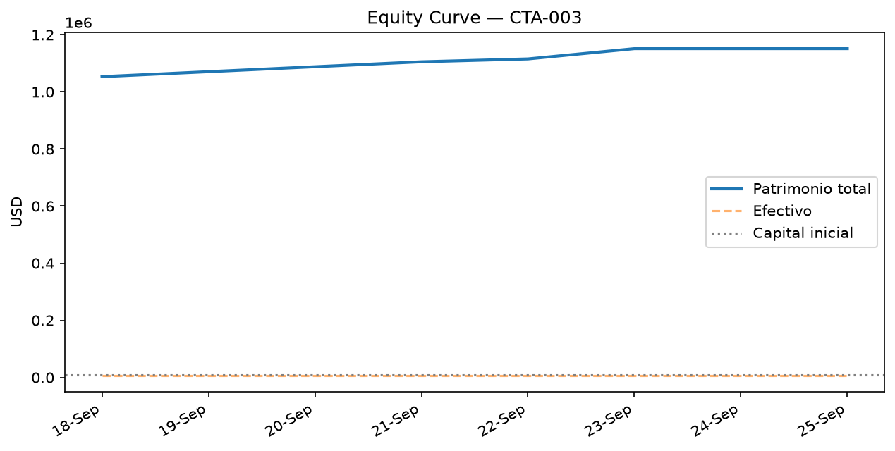
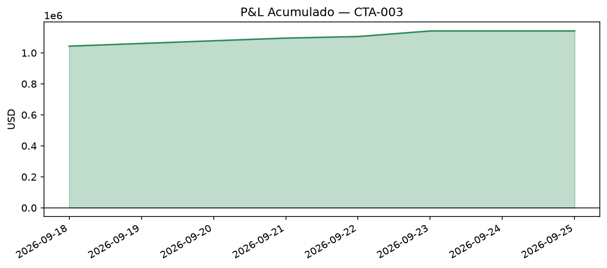
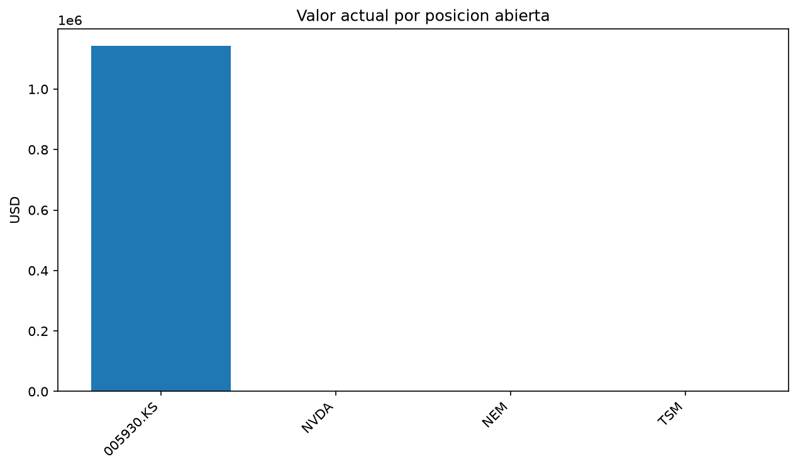
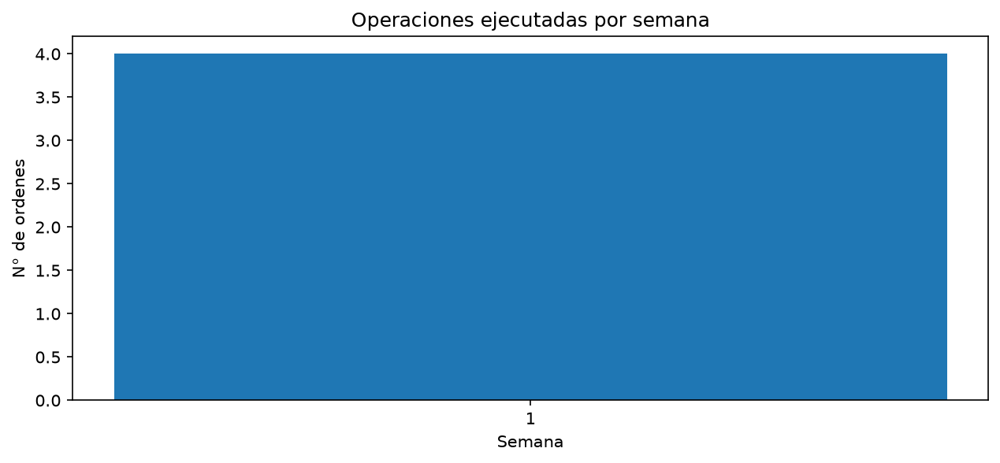

# Reporte Visual de Desempeño — CTA-003 (R3, Sprint 8)

**Generado el:** 2026-09-25

## Métricas principales

- Patrimonio actual: **$1151339.25** (capital inicial: $10000.00)
- Retorno total: **11413.39%**
- Máximo drawdown: **-0.00%**
- Semanas operadas: **1**
- Órdenes ejecutadas en total: **4**
- Tickers distintos operados: **4**
- Circuit breaker: 🔴 activo

## Equity Curve

## P&L Acumulado

## Posiciones Abiertas

| ticker    |   cantidad |   precio_promedio_compra |   precio_actual |   costo_total |   valor_actual |   pnl_no_realizado |   pnl_pct |
|:----------|-----------:|-------------------------:|----------------:|--------------:|---------------:|-------------------:|----------:|
| 005930.KS |          4 |                   183.42 |       285500    |        733.68 |      1.142e+06 |        1.14127e+06 | 155554    |
| NVDA      |          4 |                   213.9  |          224.58 |        855.6  |    898.32      |       42.72        |      4.99 |
| NEM       |          7 |                   121.76 |          121.3  |        852.32 |    849.1       |       -3.22        |     -0.38 |
| TSM       |          1 |                   417.72 |          451.15 |        417.72 |    451.15      |       33.43        |      8    |

## Operaciones Realizadas

|   semana | fecha               | ticker    |   cantidad |   precio_compra |   costo |
|---------:|:--------------------|:----------|-----------:|----------------:|--------:|
|        1 | 2026-09-18 00:00:00 | 005930.KS |          4 |          183.42 |  733.68 |
|        1 | 2026-09-18 00:00:00 | NEM       |          7 |          121.76 |  852.32 |
|        1 | 2026-09-18 00:00:00 | NVDA      |          4 |          213.9  |  855.6  |
|        1 | 2026-09-18 00:00:00 | TSM       |          1 |          417.72 |  417.72 |
