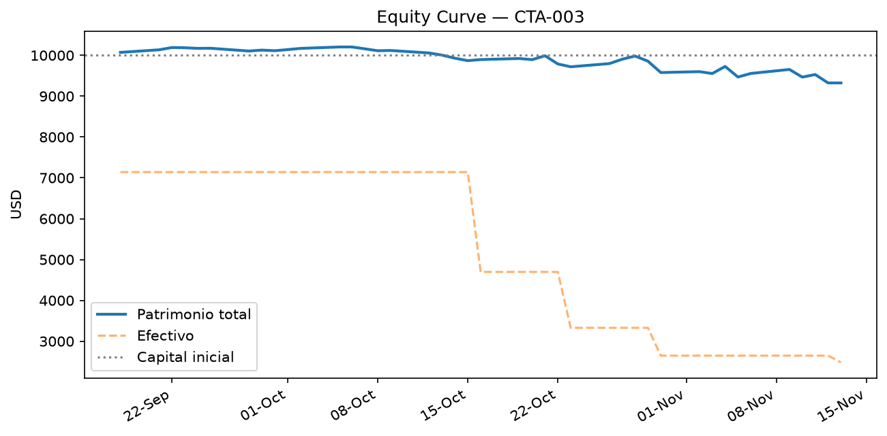
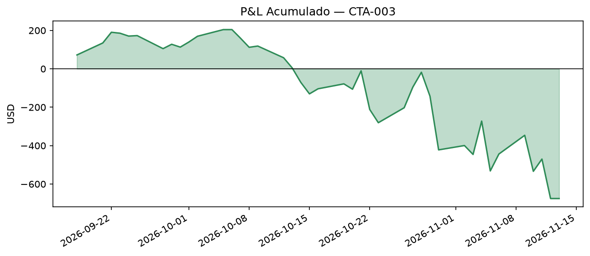
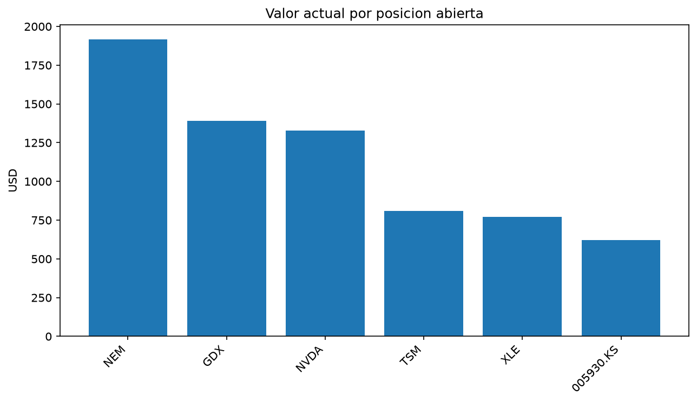
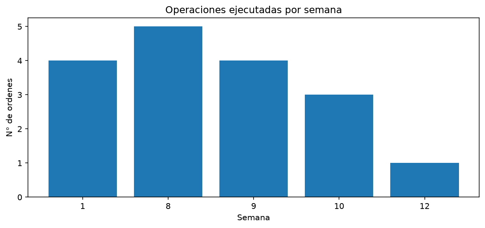

# Reporte Visual de Desempeño — CTA-003 (R3, Sprint 8)

**Generado el:** 2026-11-13

## Métricas principales

- Patrimonio actual: **$9324.43** (capital inicial: $10000.00)
- Retorno total: **-6.76%**
- Máximo drawdown: **-8.62%**
- Hit-rate promedio: **25.0%**
- Semanas operadas: **5**
- Órdenes ejecutadas en total: **17**
- Tickers distintos operados: **6**
- Circuit breaker: 🟢 inactivo

## Equity Curve

## P&L Acumulado

## Posiciones Abiertas

| ticker    |   cantidad |   precio_promedio_compra |   precio_actual |   costo_total |   valor_actual |   pnl_no_realizado |   pnl_pct |
|:----------|-----------:|-------------------------:|----------------:|--------------:|---------------:|-------------------:|----------:|
| NEM       |         17 |                   117.48 |          112.64 |       1997.2  |        1914.88 |             -82.32 |     -4.12 |
| GDX       |         17 |                    83.84 |           81.84 |       1425.26 |        1391.28 |             -33.98 |     -2.38 |
| NVDA      |          8 |                   214.49 |          166.19 |       1715.93 |        1329.52 |            -386.41 |    -22.52 |
| TSM       |          2 |                   419.98 |          405.49 |        839.97 |         810.98 |             -28.99 |     -3.45 |
| XLE       |         12 |                    67.06 |           64.33 |        804.78 |         771.96 |             -32.82 |     -4.08 |
| 005930.KS |          4 |                   183.42 |          155.66 |        733.68 |         622.63 |            -111.05 |    -15.14 |

## Operaciones Realizadas

|   semana | fecha               | ticker    |   cantidad |   precio_compra |   costo |
|---------:|:--------------------|:----------|-----------:|----------------:|--------:|
|        1 | 2026-09-18 00:00:00 | 005930.KS |          4 |          183.42 |  733.68 |
|        1 | 2026-09-18 00:00:00 | NEM       |          7 |          121.76 |  852.32 |
|        1 | 2026-09-18 00:00:00 | NVDA      |          4 |          213.9  |  855.6  |
|        1 | 2026-09-18 00:00:00 | TSM       |          1 |          417.72 |  417.72 |
|        8 | 2026-10-16 00:00:00 | GDX       |          7 |           87.02 |  609.14 |
|        8 | 2026-10-16 00:00:00 | NEM       |          5 |          115.79 |  578.95 |
|        8 | 2026-10-16 00:00:00 | NVDA      |          2 |          217.23 |  434.46 |
|        8 | 2026-10-16 00:00:00 | TSM       |          1 |          422.25 |  422.25 |
|        8 | 2026-10-16 00:00:00 | XLE       |          6 |           66.56 |  399.36 |
|        9 | 2026-10-23 00:00:00 | GDX       |          5 |           81.69 |  408.45 |
|        9 | 2026-10-23 00:00:00 | NEM       |          3 |          114.11 |  342.33 |
|        9 | 2026-10-23 00:00:00 | NVDA      |          1 |          212.21 |  212.21 |
|        9 | 2026-10-23 00:00:00 | XLE       |          6 |           67.57 |  405.42 |
|       10 | 2026-10-30 00:00:00 | GDX       |          3 |           81.33 |  243.99 |
|       10 | 2026-10-30 00:00:00 | NEM       |          2 |          111.8  |  223.6  |
|       10 | 2026-10-30 00:00:00 | NVDA      |          1 |          213.66 |  213.66 |
|       12 | 2026-11-13 00:00:00 | GDX       |          2 |           81.84 |  163.68 |
