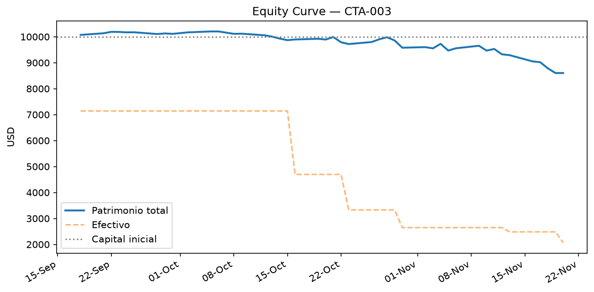
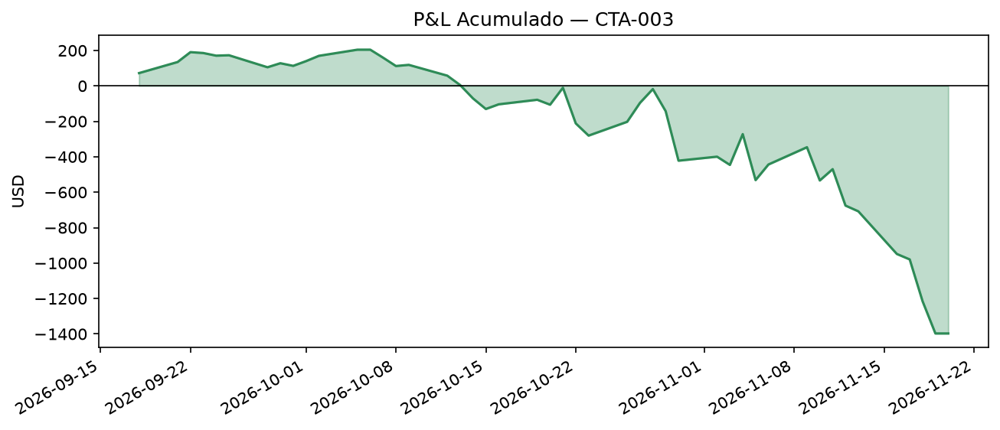
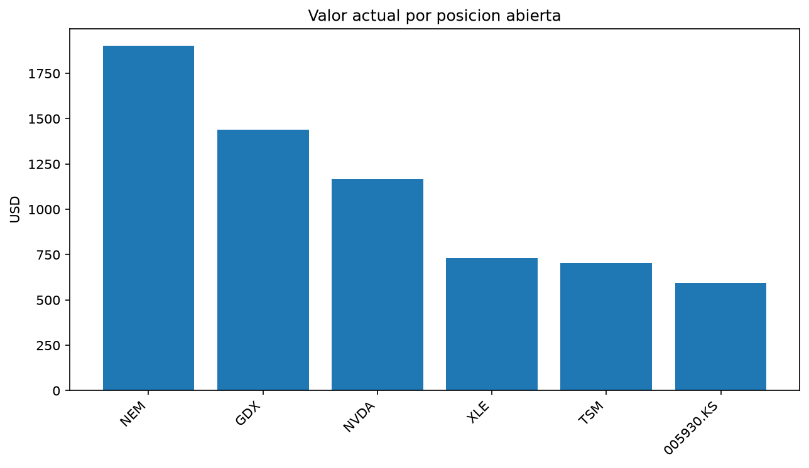
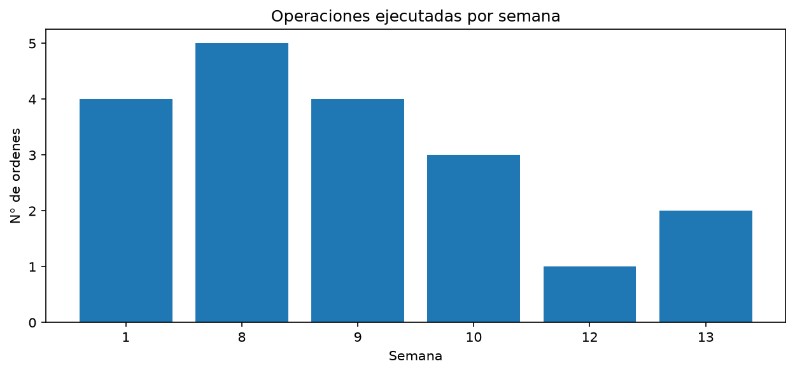

# Reporte Visual de Desempeño — CTA-003 (R3, Sprint 8)

**Generado el:** 2026-11-20

## Métricas principales

- Patrimonio actual: **$8602.73** (capital inicial: $10000.00)
- Retorno total: **-13.97%**
- Máximo drawdown: **-15.70%**
- Hit-rate promedio: **25.0%**
- Semanas operadas: **6**
- Órdenes ejecutadas en total: **19**
- Tickers distintos operados: **6**
- Circuit breaker: 🟢 inactivo

## Equity Curve

## P&L Acumulado

## Posiciones Abiertas

| ticker    |   cantidad |   precio_promedio_compra |   precio_actual |   costo_total |   valor_actual |   pnl_no_realizado |   pnl_pct |
|:----------|-----------:|-------------------------:|----------------:|--------------:|---------------:|-------------------:|----------:|
| NEM       |         19 |                   115.65 |          100.05 |       2197.3  |        1900.95 |            -296.35 |    -13.49 |
| GDX       |         20 |                    82.06 |           72    |       1641.26 |        1440    |            -201.26 |    -12.26 |
| NVDA      |          8 |                   214.49 |          145.98 |       1715.93 |        1167.84 |            -548.09 |    -31.94 |
| XLE       |         12 |                    67.06 |           60.89 |        804.78 |         730.68 |             -74.1  |     -9.21 |
| TSM       |          2 |                   419.98 |          352.09 |        839.97 |         704.18 |            -135.79 |    -16.17 |
| 005930.KS |          4 |                   183.42 |          148    |        733.68 |         592    |            -141.68 |    -19.31 |

## Operaciones Realizadas

|   semana | fecha               | ticker    |   cantidad |   precio_compra |   costo |
|---------:|:--------------------|:----------|-----------:|----------------:|--------:|
|        1 | 2026-09-18 00:00:00 | 005930.KS |          4 |          183.42 |  733.68 |
|        1 | 2026-09-18 00:00:00 | NEM       |          7 |          121.76 |  852.32 |
|        1 | 2026-09-18 00:00:00 | NVDA      |          4 |          213.9  |  855.6  |
|        1 | 2026-09-18 00:00:00 | TSM       |          1 |          417.72 |  417.72 |
|        8 | 2026-10-16 00:00:00 | GDX       |          7 |           87.02 |  609.14 |
|        8 | 2026-10-16 00:00:00 | NEM       |          5 |          115.79 |  578.95 |
|        8 | 2026-10-16 00:00:00 | NVDA      |          2 |          217.23 |  434.46 |
|        8 | 2026-10-16 00:00:00 | TSM       |          1 |          422.25 |  422.25 |
|        8 | 2026-10-16 00:00:00 | XLE       |          6 |           66.56 |  399.36 |
|        9 | 2026-10-23 00:00:00 | GDX       |          5 |           81.69 |  408.45 |
|        9 | 2026-10-23 00:00:00 | NEM       |          3 |          114.11 |  342.33 |
|        9 | 2026-10-23 00:00:00 | NVDA      |          1 |          212.21 |  212.21 |
|        9 | 2026-10-23 00:00:00 | XLE       |          6 |           67.57 |  405.42 |
|       10 | 2026-10-30 00:00:00 | GDX       |          3 |           81.33 |  243.99 |
|       10 | 2026-10-30 00:00:00 | NEM       |          2 |          111.8  |  223.6  |
|       10 | 2026-10-30 00:00:00 | NVDA      |          1 |          213.66 |  213.66 |
|       12 | 2026-11-13 00:00:00 | GDX       |          2 |           81.84 |  163.68 |
|       13 | 2026-11-20 00:00:00 | GDX       |          3 |           72    |  216    |
|       13 | 2026-11-20 00:00:00 | NEM       |          2 |          100.05 |  200.1  |
